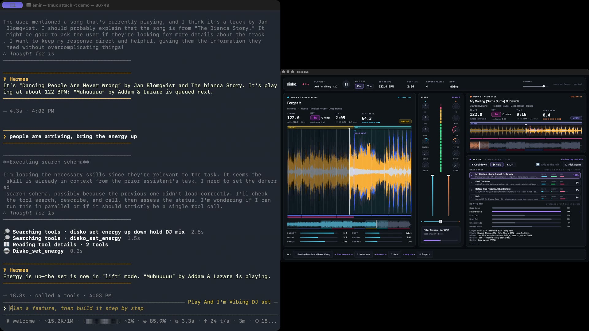

# disko for Hermes

Run an AI DJ set on your Mac from any Hermes chat.

[disko](https://github.com/emirkaan5/disko) is a desktop AI DJ. You give it a folder of music or a Spotify playlist;
its model, Kev, picks each next track, plans the transition (bass swap, filter sweep, echo out…)
and beat-matches it, and the mix plays out loud on your Mac. This plugin is the remote control:
text Hermes from the couch, from Telegram, from your phone, and the set follows.

```
you     put on a set from ~/Music/Friday, start mellow
hermes  disko is open on Friday (212 tracks). Starting with Aya – Morning Glass on MacBook Speakers.
you     what's this track?
hermes  Bo – Night Drive, 124 BPM in 9A, about two minutes left. Peak Hour is next, a bass swap in 0:42.
you     people are arriving, bring it up
hermes  Energy is on lift. Kev dropped the queued track and is picking a bigger one.
```



A real run: Hermes opened disko on a folder with `disko_launch`, started the set once you said
so, and set the energy to lift; Kev is now mixing into its next pick.

## What it adds to Hermes

| Surface | What you get |
|---|---|
| **10 tools** (`disko` toolset) | `disko_status`, `disko_find_tracks`, `disko_start`, `disko_set_energy`, `disko_pick_again`, `disko_pause`, `disko_resume`, `disko_stop`, `disko_launch`, `disko_quit` |
| **`/disko` slash command** | The same controls with no model turn, so they answer instantly in any chat app: `/disko`, `/disko start night drive`, `/disko up`, `/disko next`, `/disko pause`, `/disko tracks aya`, `/disko launch ~/Music/Friday`, `/disko launch --spotify liked` |
| **`hermes disko` CLI** | The same again from a terminal: `hermes disko`, `hermes disko up` |
| **Now-playing context** (`pre_llm_call` hook) | While a set is running, each message carries one line with the current track, the next one and the energy, so "what's this?" needs no tool call. Silent when nothing is playing. Turn it off with `now_playing_context: false`. |
| **`disko:disko-dj` skill** | The procedure and the pitfalls: confirm before starting, report only what disko says, don't invent reasons for Kev's picks. |

## Requirements

- macOS, with [disko](https://github.com/emirkaan5/disko) set up (its README covers the virtual
  environments). The disko app serves the control interface by default; with no window, run
  `python -m live --headless --playlist FOLDER`.
- Hermes 0.21.5 or newer.
- No Python dependencies: the plugin uses the standard library only.

## Install

```bash
hermes plugins install emirkaan5/hermes-disko
hermes plugins enable disko
```

That's all. Open disko once on this Mac: it registers where it is installed, so Hermes can open
it for you later (`disko_launch`, `/disko launch`) with no settings. Then check it: with disko
open, run `hermes disko` or type `/disko` in a chat.

Settings are optional, in Hermes Desktop under Settings → Plugins → disko, or in
`~/.hermes/config.yaml`:

```yaml
plugins:
  entries:
    disko:
      settings:
        disko_dir: ~/Projects/disko   # only to override the disko that registered itself
```

### Settings

| Setting | Default | Meaning |
|---|---|---|
| `disko_dir` | (empty) | Optional override for launching: your disko checkout. Empty means the disko that registered itself when it was last opened. |
| `disko_python` | (empty) | Optional override: the Python that runs disko. Empty means the one disko registered, or `<disko_dir>/.venv-live/bin/python` when `disko_dir` is set. |
| `now_playing_context` | `true` | Add the now-playing line to messages while a set runs. |
| `control_dir` | `~/.disko` | Where disko's control socket and install record are. |
| `control_url` | (empty) | `http://host:port` of a disko started with `--control-tcp`, for a Hermes in a container or on another machine. |
| `control_token` (secret, `DISKO_CONTROL_TOKEN`) | (empty) | The token for `control_url`. Not used for a local disko. |

## What it does on your machine

Everything the plugin does, so you can decide before installing:

- **Local socket.** It talks to disko over disko's control socket, `~/.disko/control.sock`.
  disko only answers a process running as the same macOS user, so no token is involved.
- **One file read outside its own data.** `~/.disko/install.json`, which disko writes (0600) on
  every start: the path of the disko folder and of the Python that runs it, so `disko_launch`
  can find disko. It is not a credential. The plugin reads no token or credential file.
- **No third-party network calls.** With `control_url` set, it makes HTTP requests to that
  address, which you chose, and nowhere else. That link is plain HTTP protected by the token;
  keep it on a network you trust.
- **A background process, when you ask.** `disko_launch` and `/disko launch` start disko with a
  fixed command, `<python> -m live --headless --playlist <folder>` or `--spotify <playlist>`
  (`--control` with a window), in the disko folder from `install.json` (or
  `disko_dir`/`disko_python` if you set them). No shell is used. The folder must be an existing
  directory; the Spotify playlist must be `liked` or a Spotify playlist id (a link is reduced to
  its id), so nothing else from the conversation reaches the command.
  disko keeps running after Hermes exits, and writes its output to
  `~/.hermes/plugin-data/disko/disko.log`. `disko_quit` ends only a disko this plugin started.
  disko itself reads the music folder and saves its analysis in a `disko/` subfolder there.
- **Spotify, only if you use it.** With a Spotify playlist, disko itself (not the plugin) uses
  your own disko Spotify sign-in to read the playlist and fetch the tracks' audio. disko refuses
  unless you turned Spotify audio on in disko yourself; the plugin never turns it on, and the
  skill tells the agent not to.
- **Sound.** `disko_start` plays music out loud on the Mac running disko. The skill tells the
  agent to confirm with you first.
- **Context.** While a set is running, the hook adds one line (track names, BPM, key, energy)
  to your message, which goes to your model provider with the rest of the conversation.
- **Credentials.** None for a local disko. The remote token (`control_url` only) is read through
  Hermes's secret store.
- **No telemetry, no self-update, no bundled binaries.**

## Limits

- It steers the *next* track. There is no way to cut the current track short.
- Kev's reasons for a pick aren't exposed, so the agent can tell you what is playing, not why.
- `disko_quit` only knows about a disko launched since Hermes last started.
- A folder disko hasn't seen is analysed before it opens (about half a second per track), and a
  Spotify playlist needs a 30 s preview of each track first, so the first launch takes a while; `disko_launch` says so and you check back.

## Development

```bash
python3.11 -m unittest discover tests     # any Python 3.11+
hermes plugins validate . --install-deps
hermes plugins doctor . --ci
```

The tests run the plugin against a fake disko on a real Unix socket (`tests/fake_disko.py`),
including launching and quitting it as a subprocess.

## License

AGPL-3.0, the same as disko.
